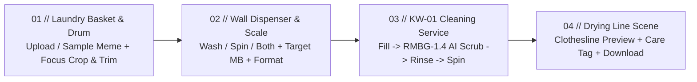

# KILOWASH // SYS-24H

**100% Client-Side AI Background Remover & Target-MB Image / Video / GIF Compressor — inside an interactive 2.5D Neo-Brutalist × Swiss Style Laundromat.**

Drop an image, animated GIF, or short video clip into the front-load washer drum, dial in your target file size in megabytes, hit **START** on the machine, watch your media scrub and spin through a multi-stage cleaning cycle, and pick up the finished cutout hanging on the clothesline.

---

## Key Features

- **Diegetic 2.5D Laundromat Room (Zero Generic Forms)**
  - **Scene 1 — Washer Room:** Features an animated day/night window, neon `KILOWASH // OPEN 24H` signage, an interactive **Dirty Laundry Basket** (with built-in **MEME IMG** and **MEME VID** demo generators), a wall-mounted **Detergent Pod Dispenser**, a **Digital Target-MB Weight Scale**, an **Output Drain Valve**, and the centerpiece **Model KW-01 Washer** with a physical **START** button and rotary program knob.
  - **Scene 2 — Drying Line:** Once the cycle completes, the room transitions to the clothesline where your transparent cutout (or compressed media) sways from two clothespins beside a **Care Tag Receipt**, complete with backdrop cloth testing (`Transparent`, `#00FF00` Green Screen, `Dark Slate`, `White Linen`), Before/After peek, and one-click download. A **Spot Bleach & Fabric Patch** tool shelf lets you erase leftover background or restore cloth from the original (8–64px brush, 10-step undo/redo) — edits are re-encoded into the receipt, so the download always matches what you see.
- **Day Shift & Night Shift (`rishichawda/fluffy-robin-48`)**
  - Switch seamlessly between **Day Shift** (warm concrete tiles, drifting clouds, diagonal sunbeams) and **Night Shift** (midnight slate walls, twinkling stars, string bulbs, and neon glow reflections).
- **General-Object AI Background Removal (`briaai/RMBG-1.4`)**
  - Runs **`briaai/RMBG-1.4`** directly in the browser via `@huggingface/transformers`—accurately isolating vehicles, illustrations, products, characters, and memes without cutting holes in high-contrast subjects.
  - Executes inside a **dedicated Web Worker** (`src/workers/mediaWorker.ts`, WebGPU `fp16` when an adapter exists, WASM `q8` otherwise), so the washer drum, 3D voxel operator and audio loops stay at **60 FPS** even during long video cycles.
  - Includes a **Pre-Treat Focus Crop Box** (drag/resize or quick `FULL FRAME` / `CENTER 75%` / `TIGHT SUBJECT 50%` presets), **Video Trim & FPS (`10 / 12 / 15 FPS`, up to 8s)**, **Temporal Alpha Smoothing** to reduce video edge flicker, and an offline Sobel edge-barrier fallback.
- **Exact Target-MB Compression Solver**
  - **Images (`WebP Transparent`, `PNG Transparent`, `JPG Solid White`):** Uses binary search over lossy quality and adaptive resolution scaling (or `gifenc` RGBA quantization for PNG) to land cleanly below your Target MB.
  - **Videos & Memes (`GIF Transparent`, `WebM Transparent`, `Video Green Screen #00FF00`):** Encodes transparent GIFs with `gifenc` (iterative color palette & scale tuning) and WebM/Green-Screen videos via `MediaRecorder` bitrate budgeting.
- **Procedural Laundry SFX (Web Audio API)**
  - Synthesizes mechanical dial ticks, door latch clunks, water filling, rhythmic wash sloshing, rising centrifuge turbine spins, and a completion chime—with an `SFX ON / SFX OFF` mute toggle in the top header and zero external audio files.
- **3D Voxel Creator Spotlight (`Three.js` + `GLTFLoader`)**
  - Compact animated 3D voxel operator in the top-right header (`public/models/lee-voxel.glb`) that reacts to the active laundry stage—shaking a detergent bottle while idle, scrubbing clothes in a mini suds tub during wash, cheering during high-speed spin, and waving a clean towel on the drying line—with a Neo-Brutalist creator popover card on click.

---

## Architecture



### Tech Stack

| Layer | Technology |
| :--- | :--- |
| **Framework** | React 18 + TypeScript + Vite |
| **Styling & Motion** | Tailwind CSS + Framer Motion + Custom CSS Variables (Palet A: Swiss Coin-Op 24H) |
| **Icons** | Lucide React |
| **In-Browser AI** | `@huggingface/transformers` (`briaai/RMBG-1.4`, WebGPU `fp16` / WASM `q8` ONNX) inside a dedicated Web Worker |
| **GIF & Palette Engine** | `gifenc` (in the worker) + `OffscreenCanvas` + `MediaRecorder` + WebCodecs `ImageDecoder` |

---

## Getting Started

### Prerequisites
- Node.js 18+ and npm

### Installation & Local Development

```bash
# Install dependencies
npm install

# Start Vite development server (port 5156)
npm run dev

# Or explicitly pass port 5156
npx vite --port 5156
```

### Production Build

```bash
npm run build
npm run preview
```

### Smoke Test

```bash
npx playwright install chromium   # once, if the browser is missing
npm run smoke
```

Builds the project, serves `dist/` on port 5157, then drives two cycles in Chromium:

- **Online:** sample image → PNG 0.05 MB. Asserts the worker chunk boots, RMBG-1.4 segments the frame, the PNG Target-MB solver lands under budget.
- **Offline:** same image with the model hosts blocked. Asserts the Sobel `OFFLINE FALLBACK` segmentation still completes the cycle with real transparency.

The first run downloads the RMBG-1.4 weights into the test browser profile (~40 s warm, roughly 100 s on the WASM fallback).

---

## Privacy & Processing Notes

- **Zero Server Uploads:** All images, GIFs, and videos stay strictly inside your browser tab.
- **First-Run AI Model Cache:** On the first **Wash** cycle, `briaai/RMBG-1.4` is downloaded from Hugging Face and cached in browser storage for instant reuse on subsequent runs — `~88 MB` (`fp16`, WebGPU) when an adapter is available, otherwise `~44 MB` (`q8`, WASM).
- **Video Window:** Video/animated GIF processing caps clip duration at **8 seconds** (`10`, `12`, or `15 FPS`) to keep client-side browser memory responsive.
